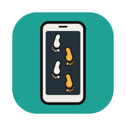
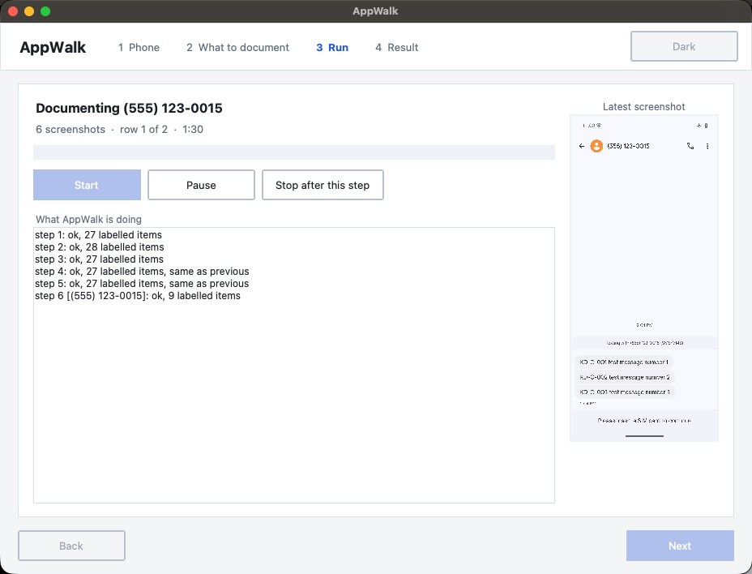
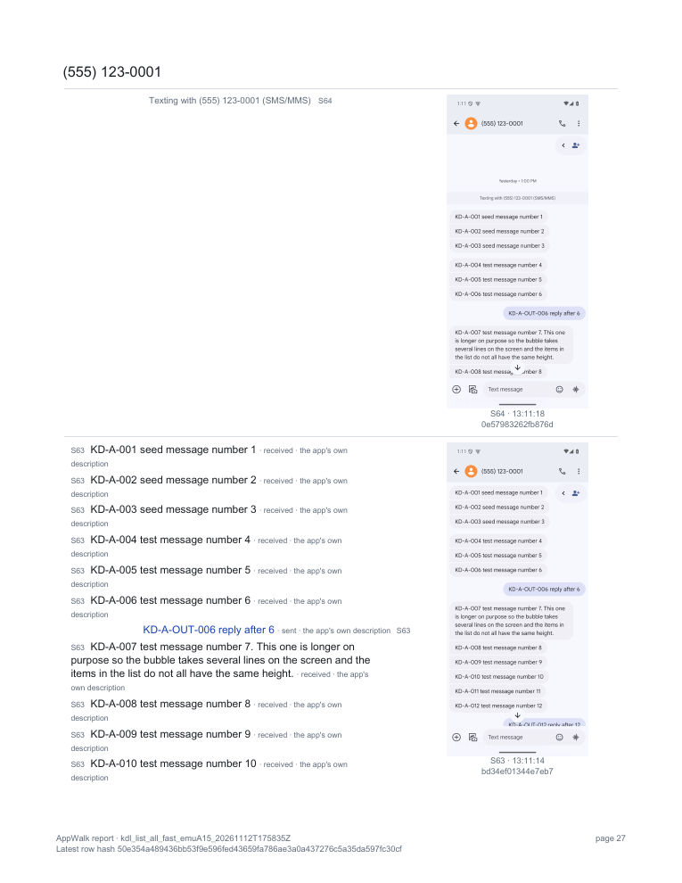

<p align="center"></p>

# AppWalk

AppWalk documents what an Android app shows. It runs on your computer and drives the phone over a
USB cable. You open the app on the phone. AppWalk scrolls through it, saves a screenshot of every
screen with the text the app reported for it, and keeps a hash-chained log of everything it did. At
the end you get a PDF report with each screenshot next to its text.



## Who it is for

Examiners working on a phone they are allowed to examine, with the owner's consent or other lawful
authority. AppWalk does not unlock anything and does not get around any lock. If a lock or a password
prompt comes up, it stops and waits for you.

It installs nothing on the phone, though it does change it a little. USB debugging has to be on, and a
conversation AppWalk opens can be marked read, just as if you had opened it yourself. Use airplane
mode, and take your extraction first if you plan one.

## Get it

Download a build for macOS, Windows or Linux from
[Releases](https://github.com/abrignoni/appwalk/releases). The builds are not signed yet; the
README.txt inside each one says how to open it. AppWalk also needs adb: install Android's
[SDK Platform-Tools](https://developer.android.com/tools/releases/platform-tools) once.

Or run it from the source with Python 3.12:

```bash
git clone https://github.com/abrignoni/appwalk.git
cd appwalk
python3.12 -m pip install customtkinter reportlab pillow
python3.12 appwalk_gui.py
```

Windows and Ubuntu have their own steps in the manual.

## What you get



Each run writes a folder with the screenshots, the view trees, the log, a transcript and the report.
The report shows the latest row hash. Write it down: it covers every row and every picture, so the
export can be checked against it later.

Profiles tell AppWalk which lines are messages, times and pictures, and who sent or wrote them. They
ship for Google Messages, Fossify Messages, WhatsApp, Signal, Discord and Instagram. For any other app,
**Teach this app** builds one from a few clicks on a screenshot.

## Learn more

- [Quick start](docs/QUICKSTART.md): the window, step by step.
- [User manual](docs/USER_MANUAL.md): installing, preparing the phone, how a walk works, the report,
  profiles, the command line and troubleshooting.
- `python3 appwalk.py --help`: the command line.

## Tested on

An Android 15 emulator with Google Messages and Fossify Messages, checked against ALEAPP, and with
Silence and a web view page. A Pixel 7a with Android 17, with WhatsApp, Signal, Discord and Instagram. The details, and what
has not been tried, are in section 14 of the manual.

## Working on the code

The unit tests need no phone:

```bash
python3 -m unittest discover -s tests
```

`devtools/` has the emulator scripts and the window driver used for testing.
`.github/workflows/build.yml` builds the release downloads and checks each one by running it.

## License

MIT, see [LICENSE](LICENSE). Third-party packages and their licences are in
[THIRD_PARTY_NOTICES.md](THIRD_PARTY_NOTICES.md).
