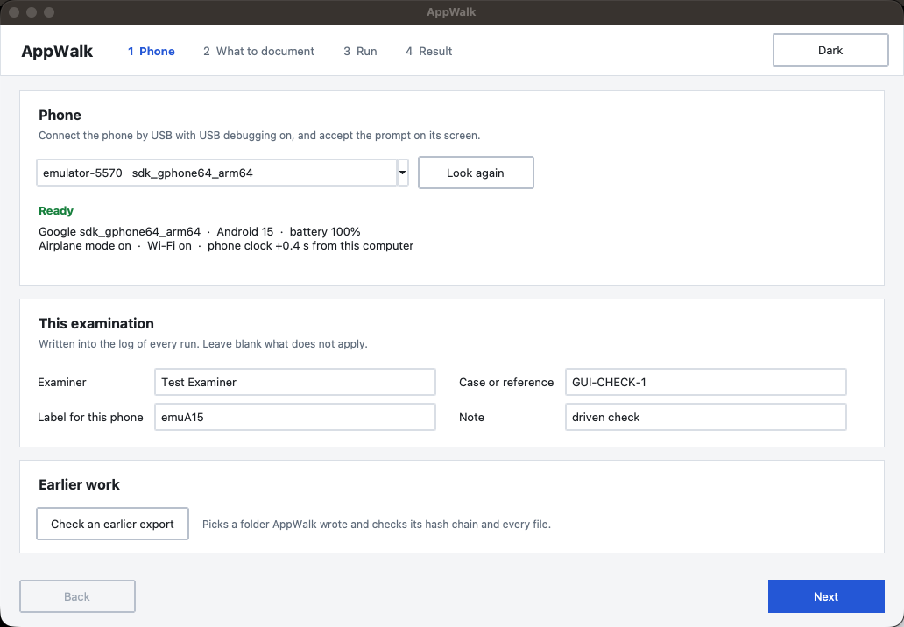
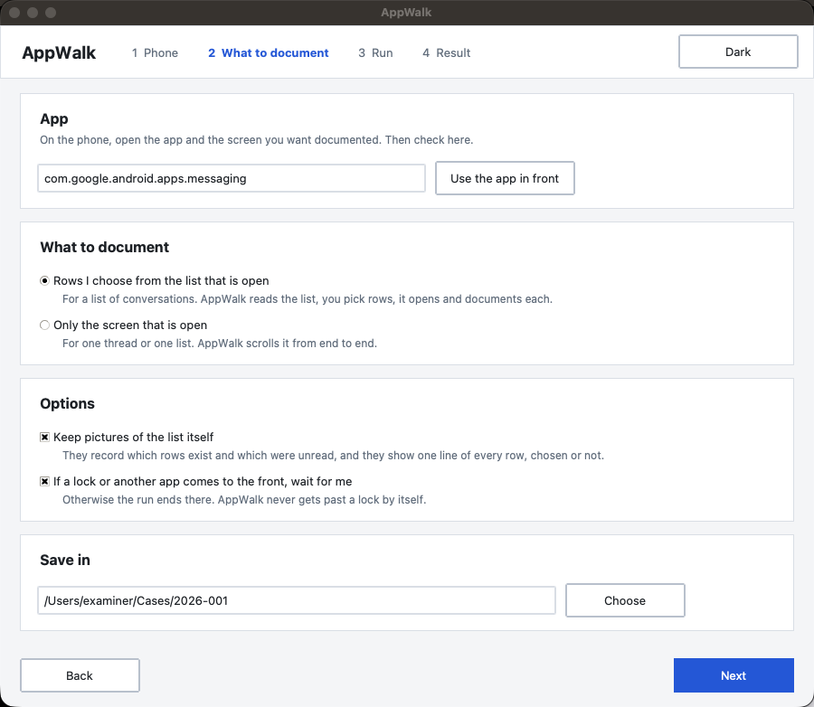
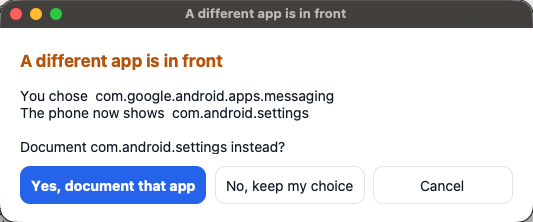
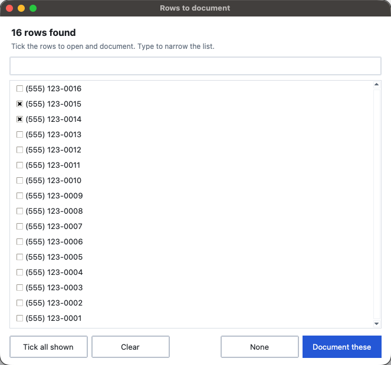
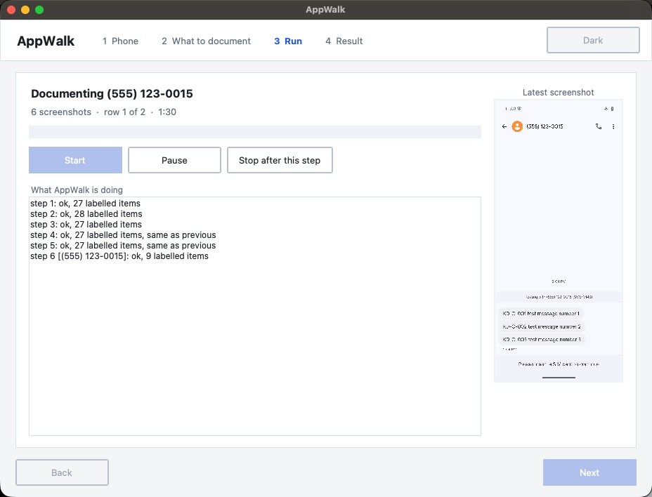
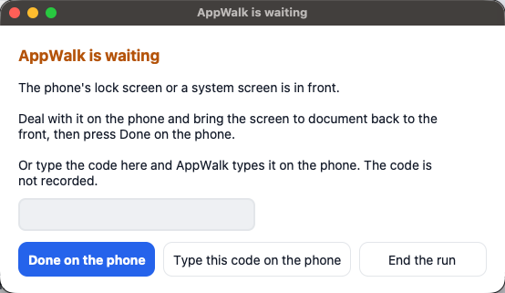
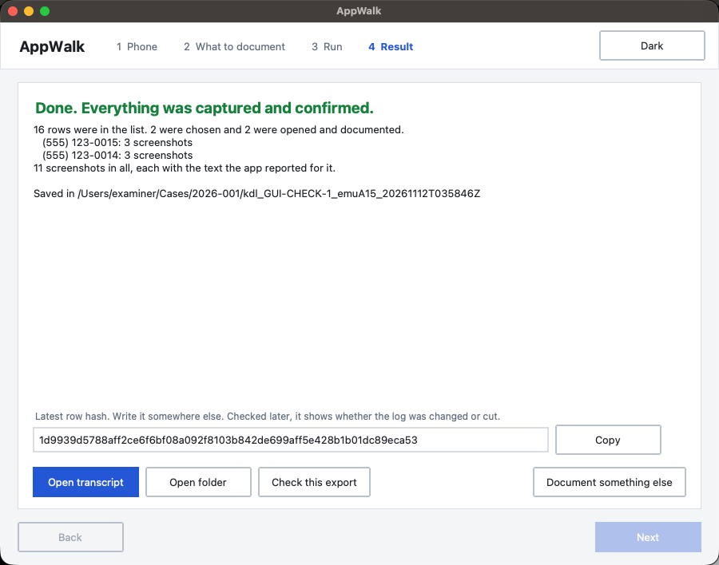
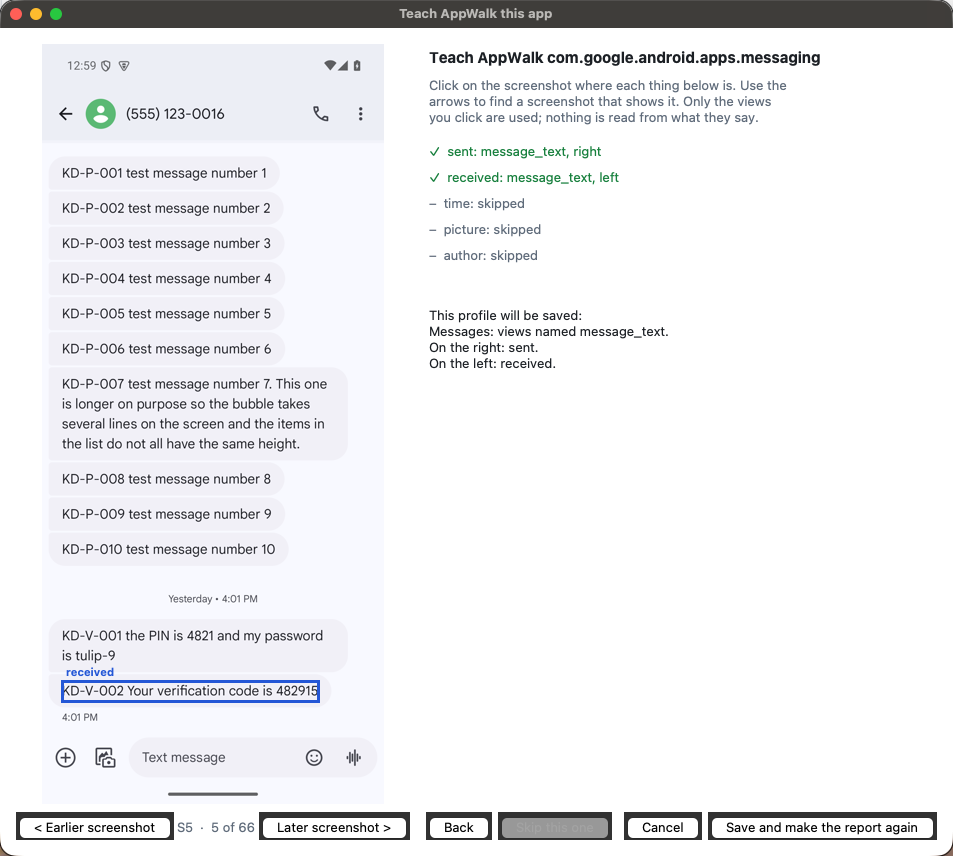

# AppWalk quick start

The short version. The [user manual](USER_MANUAL.md) has the rest: installing on each system, how a
walk works, the report, profiles, the command line, and what AppWalk was tried on.

## What AppWalk is

AppWalk documents what an app shows, so nobody has to photograph a phone screen by screen. It runs on
your computer and drives the phone over a USB cable. You open the app, it scrolls through the content
and saves a screenshot of every screen, the text the app reported for it, and a log of everything it
did.

It is for a phone you are allowed to examine: with the owner's consent or other lawful authority. It
does not unlock anything, guess anything or get around any lock. If a lock or a password prompt comes
up, it stops and waits for you.

It installs nothing on the phone. It does change the phone in these ways:

- USB debugging has to be on, and the phone stores your computer's key when you accept the prompt.
- A conversation that AppWalk opens is marked read, as it would be if you opened it. (Seen with text
  messages in Google Messages on the emulator; other apps were not measured.)
- If the phone is online, opening a conversation can send read receipts and download content. Use
  airplane mode unless you mean otherwise.

Take your extraction first if you plan one. Then use AppWalk.

## What you need

- A computer with Python and `adb` (Android platform tools). On a Mac, use Python 3.12: the window
  refuses to start on the python.org 3.14 build, whose Tk has crashed windows like this one.
- For the window and the report, three Python packages:

  ```bash
  python3.12 -m pip install customtkinter reportlab pillow
  ```

  Without CustomTkinter a plainer window opens that works the same way. Without ReportLab there is no
  PDF report; everything else is written.
- A USB cable.
- On the phone: Developer options and USB debugging switched on. To get Developer options, open
  Settings, About phone, and tap Build number seven times. Some phones ask for a fingerprint or face
  here and will not take the PIN.

## Start it

```bash
python3.12 appwalk_gui.py
```

The window has four steps, shown across the top. The Light and Dark switch in the corner changes the
colours.

## Step 1: Phone



Connect the phone and accept the "Allow USB debugging" prompt on its screen. Press **Look again** if it
does not appear in the list.

Under the phone's name the window shows its state: model, Android version, battery, airplane mode,
Wi-Fi, and how far its clock is from your computer's. Warnings appear in orange: the phone is online,
the battery is low, the screen turns off quickly, or the clocks are more than a minute apart.

Fill in **Examiner**, **Case or reference**, a **Label for this phone** and a **Note** if you have
one. The label is required. All four are written into the log of every run.

**Check an earlier export** picks a folder AppWalk wrote before and checks it. See "Check an export".

## Step 2: What to document



On the phone, open the app and the screen you want documented. The window fills in the app that is in
front. Press **Use the app in front** to read it again.

Choose one:

- **Rows I choose from the list that is open.** Open the app's list of conversations first. AppWalk
  reads the list, you tick rows, and it opens and documents each one.
- **Only the screen that is open.** For one conversation or one list. AppWalk scrolls it from end to
  end.

Options:

- **Keep pictures of the list itself.** On by default. Those pictures record which rows exist and
  which were unread. They also show one line of every row, chosen or not. Turn it off to keep only
  the rows you choose.
- **If a lock or another app comes to the front, wait for me.** On by default. Off, the run ends
  there.

**Save in** is the folder the result goes to.

## Step 3: Run

Press **Start**, then leave the phone alone until the Result page shows.

If the app in front is no longer the one you chose, AppWalk asks which one you mean before it does
anything.



With "Rows I choose", it first reads the list, then shows the rows it found. Tick the ones to
document. Type in the box to narrow a long list. **Tick all shown** takes every row that matches.



While it works, the window shows what it is documenting, how many screenshots it has, which row it is
on and the time taken. The latest screenshot fills the right half.



- **Pause** holds the run after the current screenshot of a walk. It does not hold it while the list
  is being read or a row is being looked for. Leave the phone on the same screen, then press
  **Resume**. The pause is written into the log.
- **Stop after this step** ends the run. What was captured is kept and the result says the run ended
  early.

If a lock screen, a password prompt or another app comes to the front, AppWalk waits:



Deal with it on the phone and press **Done on the phone**. Or type the code in the box and press
**Type this code on the phone**: AppWalk types it for you. In the emulator test the code was in no
file of the export. **End the run** stops there.

## Step 4: Result



The headline is green when everything was captured and each list was confirmed from end to end. It is
orange when there is something to look at, and the lines below say what: a row that would not open, a
run that was stopped, screenshots that came back black, a list whose end was not confirmed.

- **Open report** opens `report.pdf`: the case details, then each conversation in reading order, with
  every screenshot beside the lines first seen on it, so a photo is on the same page as the line that
  names it. Each line ends in an S-number, such as S12, the screenshot beside it. Screenshots that
  added no new line, such as the checks at the ends of a conversation, follow its text. A picture
  that came back the same twice is printed once, with both S-numbers.
- **Open transcript** opens a page with the text of each conversation in reading order, each line
  beside the screenshot it was first seen on.
- **Open folder** opens the folder with everything in it.
- **Check this export** checks the result against itself.
- **Latest row hash**: copy it and write it down somewhere else, such as your notes. Checked later
  against the export, it shows whether the rows up to it were changed or removed, or the log was cut
  before it. AppWalk does not do
  that check yet; KDL's `make_documentation.py <export folder> -o out.xlsx --expect-hash <hash>` does.
  Use the script from KDL 0.5.0 or later: it was run on an AppWalk export and found the noted hash,
  and a wrong hash gave a WARNING.
- **Document something else** goes back to step 2 for another app or another list on the same phone.
- **Teach this app** makes a profile for an app that has none, or replaces one; see below.
- **Close AppWalk**, at the bottom right, closes the window.

## Teach AppWalk an app

Without a profile, the transcript gives every line of an app as plain text: no sent or received,
no times picked out, no pictures named. **Teach this app** on the Result step makes a profile from
the export you just made.



The screenshots of the export are on the left; use the arrows to find one that shows what is asked
for. Click on:

1. a message you know was sent from this phone,
2. a message you know was received,
3. a time shown with a message,
4. a picture or other attachment, if the app shows one,
5. the name of who wrote a message, if the app shows names.

Each click is boxed on the screenshot, and the list on the right says which view was there and on
which side. **Skip this one** when there is nothing like it; **Back** undoes the last click. Then the
window says, in plain words, what the profile will do, with any warning: for example, that the sent
and the received message are on the same side, so the app shows one column and nothing will be
called sent or received.

**Save and make the report again** saves the profile and makes the transcript and the report of this
export again with it. The Result step then says how many messages were found, and how many sent and
received. Later exports of the same app use it too.

To teach from an earlier export, run `python3.12 appwalk.py teach <export folder>`.

Only the views you click are used. AppWalk does not read what the messages say to make the profile.
Profiles you teach are kept on this computer, in `.appwalk/profiles` in your home folder, and are used
before the ones that come with AppWalk. Check the first report made with a new profile against its
screenshots.

## What is in the folder

A folder named `kdl_<reference>_<phone label>_<time>` with:

- `screens/`: the screenshots.
- `trees/`: for each screenshot, the text and layout the app reported for that screen.
- `report.pdf` and `report.pdf.sha256`: the report, and its own hash.
- `transcript.html` and `transcript.csv`: the text in reading order.
- `actions.jsonl` and `actions.csv`: the log. One row for everything AppWalk did: each scroll, each
  screenshot with the hash of its picture, each row opened, each wait, the phone's state before and
  after, and the examiner and reference you typed.
- `manifest.json` and `text_index.csv`.

The log is a hash chain: each row carries a hash of itself and of the row before. The latest row hash
therefore covers every row and every picture.

## Reading the transcript

The transcript and the report are reading aids, made from the saved files. The screenshots are the record of what was on the screen. The text
beside them is what the app reported, which is usually the same and is not guaranteed to be.

- Left and right are where a line sat on the screen.
- "sent" and "received" appear only for apps that have a profile, and each says on what basis: the
  app's own description, or the side of the screen. There are profiles for Google Messages, Fossify
  Messages, WhatsApp, Signal, Discord, Instagram, Threads and LinkedIn.
- A line in square brackets is the description the app gave an item with no text, such as a picture.
  A bold line (Discord, LinkedIn) is the name of who wrote the lines after it.
- A line marked "joined by the screenshots" came from a screenshot that shared too little text with
  the one before (two lines that moved together are needed), where the pictures themselves showed
  that the two overlap (a photo in the shared part, for example).
- A line marked NOT JOINED means two screenshots in a row did not share enough text and the pictures
  did not clearly overlap either. Look at the pictures there: something may be missing between them.

## Check an export

**Check this export** on the Result step, **Check an earlier export** on the Phone step, or:

```bash
python3 appwalk.py verify <export folder>
```

It checks that the log file matches the manifest, that the hash chain is intact, that every
screenshot and text file matches the hash in its log row, and that there is no file without a row.

## What it does not do

- It does not get past a lock, a password or a biometric prompt.
- It cannot capture a screen the app protects from screenshots. Those come back black and the result
  says so. The text may still be in the transcript: it was for the one such app tried (Silence) and
  one Settings screen.
- It documents what is on the phone. A conversation that needs the network to load older messages is
  documented as far as the phone has it.
- It taps only the titles of the rows you choose. It does not tap inside a conversation, so it does
  not open a "view once" picture or play anything.
- It reaches only the list you put in front. Archived or hidden conversations need their own run,
  with that list open.
- Two rows with the same title: only the first is opened, and the result is meant to say so. This
  case has not been tried.
- Android only.

## If something goes wrong

- **No phone in the list.** Check the cable and the USB debugging prompt, then **Look again**. If the
  window says "adb could not be run", install the Android platform tools.
- **The screen locks during a run.** Set the screen timeout to its longest value before starting. If
  it locks, the waiting dialog comes up.
- **AppWalk says a different app is in front when you press Start.** A permission prompt, a system
  dialog or another app is on the phone's screen. Choose Cancel, clear it on the phone, and start
  again. With "wait for me" off, a run that meets one later ends there and says why.
- **The window does not start on a Mac.** Use `python3.12`.

The same runs are available without the window: `python3 appwalk.py walk --help` and
`python3 appwalk.py walk-list --help`.
