<p align="center">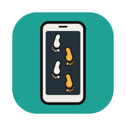</p>

# AppWalk user manual

For AppWalk 0.1.3, 14 November 2026. What it was tested on is in section 14; anything not listed there
has not been tried.

Every picture in this manual comes from AppWalk driven against an Android 15 emulator with made-up
texts: the window, the phone screens inside it, and the two report pages. None comes from a real
person's phone.

## Contents

1. [What AppWalk is](#1-what-appwalk-is)
2. [What you need](#2-what-you-need)
3. [Get AppWalk and install what it uses](#3-get-appwalk-and-install-what-it-uses)
4. [Prepare the phone](#4-prepare-the-phone)
5. [Start AppWalk](#5-start-appwalk)
6. [Step 1: Phone](#6-step-1-phone)
7. [Step 2: What to document](#7-step-2-what-to-document)
8. [Step 3: Run](#8-step-3-run)
9. [Step 4: Result](#9-step-4-result)
10. [The report and the transcript](#10-the-report-and-the-transcript)
11. [The export folder and checking it](#11-the-export-folder-and-checking-it)
12. [Teach AppWalk an app](#12-teach-appwalk-an-app)
13. [How a walk works](#13-how-a-walk-works)
14. [What it was tried on](#14-what-it-was-tried-on)
15. [What it does not do](#15-what-it-does-not-do)
16. [The command line](#16-the-command-line)
17. [Profiles by hand](#17-profiles-by-hand)
18. [If something goes wrong](#18-if-something-goes-wrong)
19. [What AppWalk keeps on your computer](#19-what-appwalk-keeps-on-your-computer)

## 1. What AppWalk is

AppWalk documents what an app shows, so nobody has to photograph a phone screen by screen. It runs on
your computer and drives the phone over a USB cable. You open the app on the phone; AppWalk scrolls
through the content and saves a screenshot of every screen, the text the app reported for that
screen, and a log of everything it did. At the end it writes a report you can open as a PDF.

It is for a phone you are allowed to examine: with the owner's consent or other lawful authority. It
does not unlock anything, guess anything or get around any lock. If a lock or a password prompt comes
up, it stops, or waits for you to deal with it.

It installs nothing on the phone. It uses three programs that are already there: `uiautomator` for the
view tree, `screencap` for the screenshot and `input` for swipes and taps. Screenshots and view trees
go straight to your computer; on the test emulator, reading the view tree left no file on the phone's
storage. It does change the phone in these ways:

- USB debugging has to be on, and the phone stores your computer's key when you accept the prompt.
- A conversation that AppWalk opens is marked read, as it would be if you opened it yourself. (Seen
  with text messages in Google Messages on the emulator; other apps were not measured.)
- If the phone is online, opening a conversation can send read receipts and download content, and new
  messages can arrive while AppWalk works. Use airplane mode unless you mean otherwise.

Take your extraction first if you plan one. Then use AppWalk.

The screenshots are the record of what was on the screen. The text AppWalk keeps next to them is what
the app reported for that screen, which is usually the same and is not guaranteed to be.

## 2. What you need

- A computer with macOS, Windows or Ubuntu. Each was tried; see section 14.
- Python. On a Mac, use Python 3.12: the window refuses to start on the python.org 3.14 build, whose
  Tk 9 has crashed windows like this one. Windows was tried with Python 3.11, Ubuntu 26.04 with its
  own Python 3.14 (whose Tk is 8.6).
- `adb`, the Android platform tools.
- A USB cable that carries data, not only charge.
- The phone, unlocked by its owner or with the code you were given.

These Python packages are used when they are installed:

| Package | What it gives | Without it |
|---|---|---|
| CustomTkinter | the window's look | a plainer window opens that works the same way |
| ReportLab | `report.pdf` | no PDF; everything else is written |
| Pillow | black screenshots flagged, screenshots compared, the pictures in the window and in the PDF | black screenshots are not flagged, each screen is read twice instead of compared, and there is no PDF |

Their licences are in `THIRD_PARTY_NOTICES.md`.

## 3. Get AppWalk and install what it uses

### Ready-made builds

A release on <https://github.com/abrignoni/appwalk/releases> carries builds for macOS, Windows and
Linux, each for ARM64 and x64, with Python and everything else inside. Each pack holds two programs:
**AppWalk**, the window, and **appwalk-cli**, the command line, with a README, the licence and the
notices. Each build was checked by running it before it was attached: the window opened and reported
what it loaded, and the command line checked and reported on a made-up export.

- The builds are not signed yet. macOS blocks an unsigned app the first time: open it, then allow it
  in **System Settings**, **Privacy & Security**, **Open Anyway**. Windows SmartScreen may warn about
  an unknown publisher: **More info**, **Run anyway**.
- adb is not inside: Android's licence for its SDK does not allow passing it on. Install Android's
  SDK Platform-Tools once, as below.

### From the source

Get AppWalk from <https://github.com/abrignoni/appwalk>, with **Code**, **Download ZIP**, or with git:

```bash
git clone https://github.com/abrignoni/appwalk.git
```

### macOS

Install Python 3.12 from python.org, then the packages:

```bash
python3.12 -m pip install customtkinter reportlab pillow
```

For `adb`, either download the SDK Platform-Tools from Android
(<https://developer.android.com/tools/releases/platform-tools>) and add the folder to your PATH, or
with Homebrew:

```bash
brew install --cask android-platform-tools
```

### Windows

Install Python from python.org (its installer includes Tk), then:

```bash
py -m pip install customtkinter reportlab pillow
```

Download the SDK Platform-Tools for Windows from the same Android page, unzip it, and add the folder
that holds `adb.exe` to your PATH.

### Ubuntu

```bash
sudo apt install adb python3-tk python3-pil python3-pil.imagetk python3-reportlab python3-venv
```

Ubuntu 26.04 does not let `pip` install into its own Python, and CustomTkinter is not one of its
packages, so put CustomTkinter in a virtual environment that can also see the packages above:

```bash
python3 -m venv --system-site-packages ~/appwalk-venv
~/appwalk-venv/bin/pip install customtkinter
```

and start AppWalk with `~/appwalk-venv/bin/python appwalk_gui.py`.

Ubuntu packs Pillow's Tk part (`python3-pil.imagetk`) separately from Pillow. Without it the window
still shows the logo and the latest screenshot, through Tk's own PNG support, at a fixed size.

These package names were checked on Ubuntu 26.04 (`apt-cache policy`). The test machine itself ran
AppWalk from packages unpacked without `sudo`, with ReportLab 4.4.6; Ubuntu's own ReportLab is
4.4.10, which was not tried.

## 4. Prepare the phone

1. Turn on Developer options. On a Pixel: **Settings**, **About phone**, then tap **Build number**
   seven times until the phone says you are now a developer. On other phones **Build number** is
   elsewhere; Android lists the places for several makers at
   <https://developer.android.com/studio/debug/dev-options>. Some phones ask for the owner's fingerprint
   or face here and will not take the PIN.
2. In **Developer options**, turn on **USB debugging**. On Android 9 and later it is under
   **Settings**, **System**, then **Developer options**.
3. Set the screen timeout to its longest value, so the phone does not lock during a run.
4. Turn on airplane mode, unless you mean the phone to be online. Do it after opening the
   conversation you want, if the app needs the network to load it.
5. Connect the cable and accept the **Allow USB debugging** prompt on the phone.

## 5. Start AppWalk

From the AppWalk folder:

```bash
python3.12 appwalk_gui.py
```

On Windows `py appwalk_gui.py`, on Ubuntu `~/appwalk-venv/bin/python appwalk_gui.py`.

The window has four steps, shown across the top. The **Light** and **Dark** switch in the corner
changes the colours; it starts in your system's setting on macOS and Windows.

## 6. Step 1: Phone

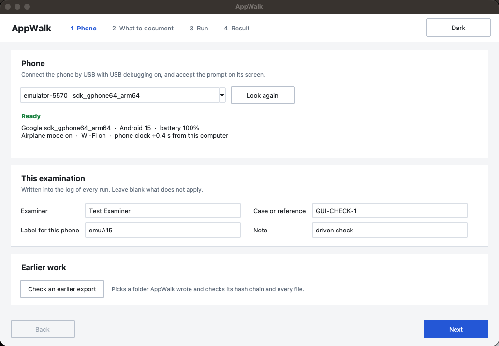

The phone appears in the list once the USB debugging prompt is accepted. Press **Look again** if it
does not.

Under the phone's name the window shows its state: model, Android version, battery, airplane mode,
Wi-Fi, and how far its clock is from your computer's. Warnings appear in orange when the phone is
online, the battery is under 20%, the screen turns off in less than 2 minutes, or the two clocks are
more than a minute apart. Both clocks are written into the log either way.

Fill in **Examiner**, **Case or reference**, a **Label for this phone** and a **Note** if you have
one. The label is required. All four are written into the log of every run.

**Check an earlier export** picks a folder AppWalk wrote before and checks it (section 11).

## 7. Step 2: What to document

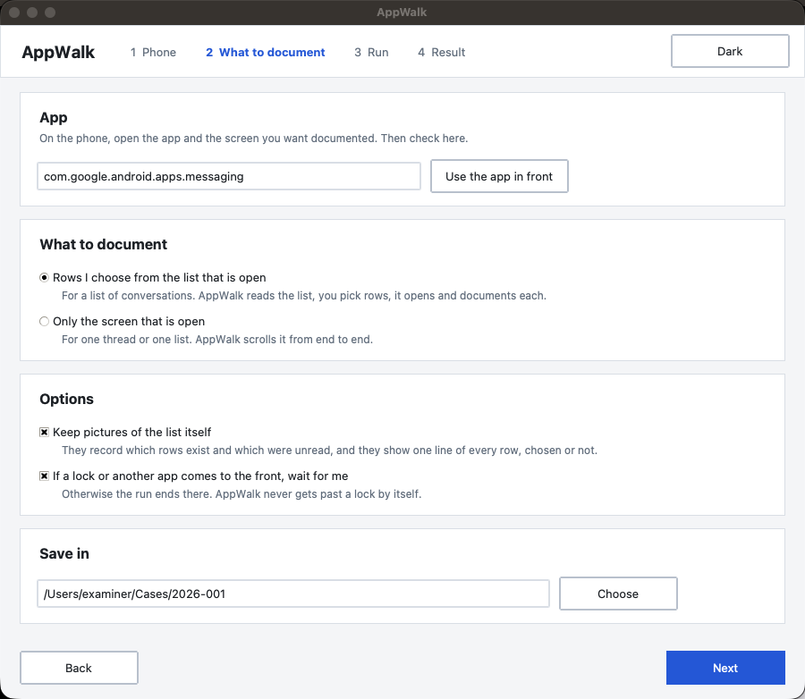

On the phone, open the app and the screen you want documented. The window fills in the app that is in
front. Press **Use the app in front** to read it again.

Choose one:

- **Rows I choose from the list that is open.** Open the app's list of conversations first. AppWalk
  reads the list, you tick rows, and it opens and documents each one.
- **Only the screen that is open.** For one conversation or one list. AppWalk scrolls it from end to
  end.

Options:

- **Keep pictures of the list itself.** On by default. Those pictures record which rows exist and
  which were unread. They also show one line of every row, chosen or not. Turn it off to keep only
  the rows you choose.
- **If a lock or another app comes to the front, wait for me.** On by default. Off, the run ends
  there and says why.

**Save in** is the folder the export goes to.

## 8. Step 3: Run

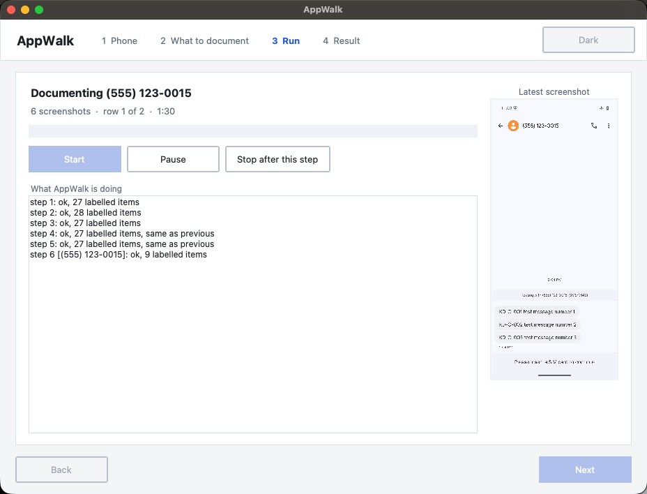

Press **Start**, then leave the phone alone until the Result step shows.

If the app in front is no longer the one you chose, AppWalk asks which one you mean before it does
anything:

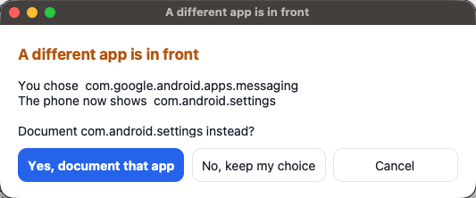

With **Rows I choose**, it first reads the list, then shows the rows it found. Tick the ones to
document. Type in the box to narrow a long list. **Tick all shown** takes every row that matches.

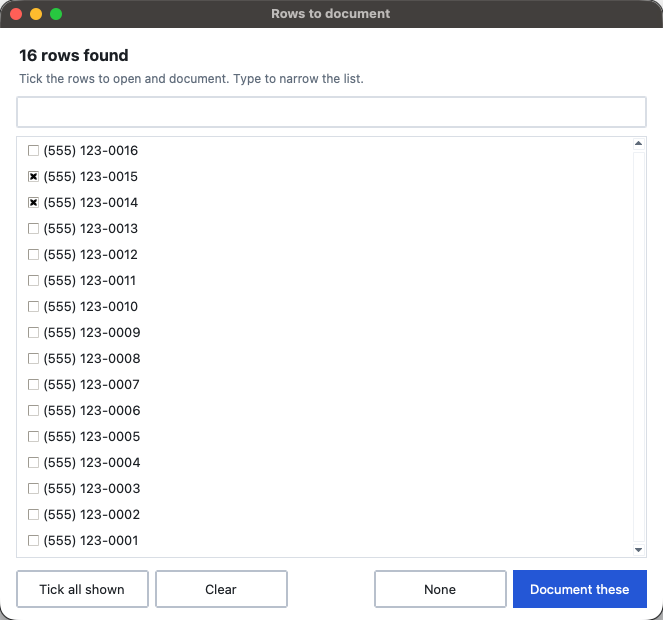

While it works, the window shows what it is documenting, how many screenshots it has, which row it is
on and the time taken. The latest screenshot fills the right half.

- **Pause** holds the run after the current screenshot of a walk. It does not hold it while the list
  is being read or a row is being looked for. Leave the phone on the same screen, then press
  **Resume**. The pause is written into the log.
- **Stop after this step** ends the run. What was captured is kept, and the result says the run ended
  early.

If a lock screen, a password prompt or another app comes to the front, AppWalk waits:

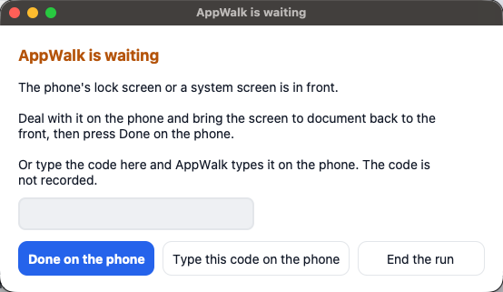

Deal with it on the phone and press **Done on the phone**. Or type the code in the box and press
**Type this code on the phone**: AppWalk types it for you. The code is not written anywhere; in the
emulator test it was in no file of the export. **End the run** stops there.

## 9. Step 4: Result

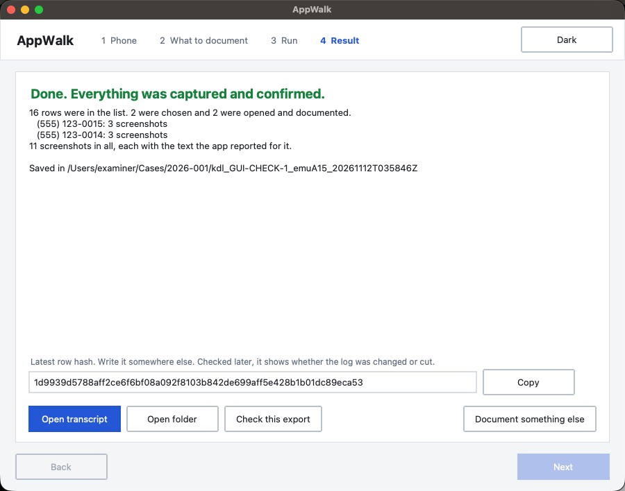

The headline is green when everything was captured and each list was confirmed from end to end. It is
orange when there is something to look at, and the lines below say what: a row that would not open, a
run that was stopped, screenshots that came back black, a list whose end was not confirmed, a report
that could not be made and why.

- **Open report** opens `report.pdf` (section 10).
- **Open transcript** opens `transcript.html`, the text of each conversation in reading order beside
  the screenshot each line was first seen on.
- **Open folder** opens the export folder.
- **Check this export** checks the export against itself (section 11).
- **Teach this app** makes a profile for this app from a few clicks (section 12).
- **Latest row hash**: copy it and write it down somewhere else, such as your notes (section 11).
- **Document something else** goes back to step 2 for another app or another list on the same phone.
- **Close AppWalk**, at the bottom right, closes the window.

## 10. The report and the transcript

Both are reading aids, made from the files of the export, and both can be made again at any time. The
screenshots and the log are the record.

### The report

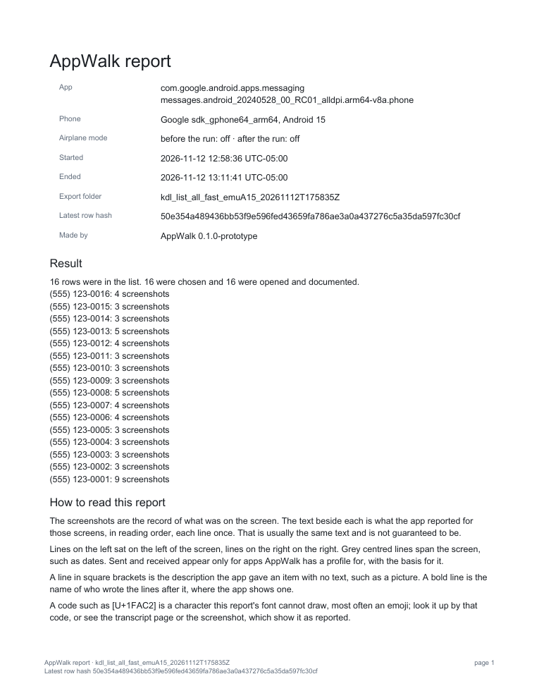

`report.pdf` starts with the case details, the phone, whether airplane mode was on before and after
the run, the start and end times, the export folder's name, the latest row hash, the result, and how
to read the report.

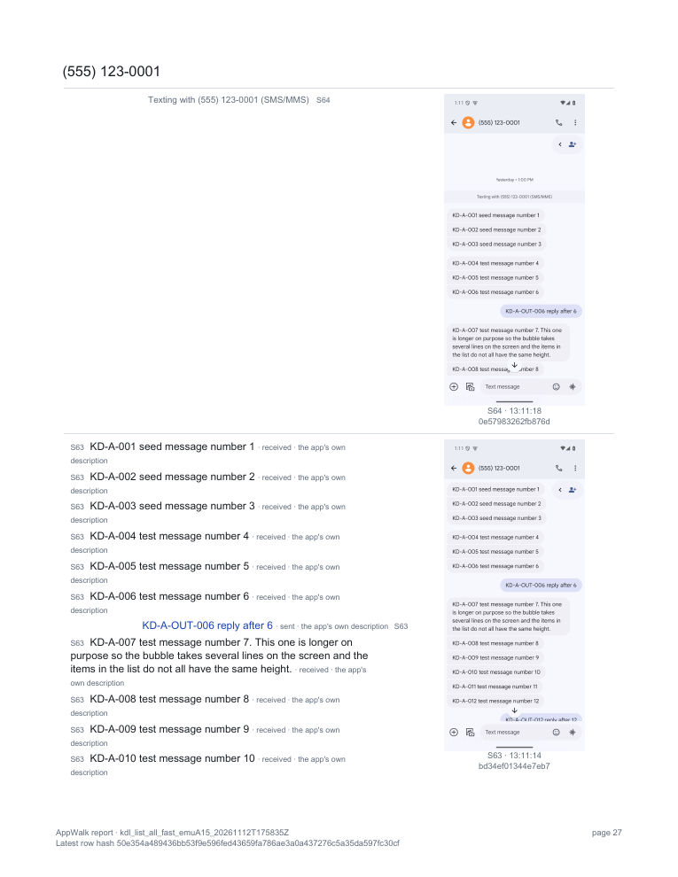

Then each conversation, in reading order, top to bottom, with every screenshot beside the lines first
seen on it. A photo is therefore on the same page as the line that names it.

- Each line ends in a tag such as S12: the screenshot it was first seen on, which is the one beside
  it.
- Lines on the left sat on the left of the screen, lines on the right on the right, as on the
  transcript page. Grey lines are times and other text the app showed, on the side they sat; centred
  ones spanned the screen, such as dates.
- Under a line, in small grey type: "sent" or "received" with its basis, the app's own description
  where it says more than the line, and how the line joined the screenshot before (see the transcript,
  below). "sent" and "received" appear only for apps AppWalk has a profile for: "the app's own
  description" when the app said so itself, or "side of the screen (inferred)".
- The notes in yellow (which profile was used, and any place the walk went back or a gap) are the
  same as at the top of the transcript page.
- A line in square brackets is the description the app gave an item with no text, such as a picture.
  It can hold more than the screenshot shows: in Discord, an image's address.
- A bold line is the name of who wrote the lines after it, where the app shows names (Discord, LinkedIn).
- A code such as [U+1FAC2] is a character the report's font cannot draw, most often an emoji. The
  transcript page and the screenshot show it as it was reported. A code from U+E000 to U+F8FF is in
  Unicode's private use area and has no meaning of its own: only the app's font draws it (Signal puts
  one before call events), so look at the screenshot. Invisible marks, such as the direction marks
  Android puts around names and numbers, are left out of the report and kept in `transcript.csv`.
- Screenshots on which no new line was seen, such as the checks at either end of a conversation,
  follow its text, three to a row.
- A screenshot that came back the same as the one before it is printed once, with both S-numbers.

The report ends with the export check and what the report does not show. Its own SHA-256 is in
`report.pdf.sha256` beside it. The report is not in the export's hash chain; the latest row hash, on
every page, covers every row and every file of the export.

### The transcript

`transcript.html` and `transcript.csv` hold the same text, one line per row, with the screenshot each
line was first seen on, where it sat, the app's own description of it, its view id, and how it was
joined to the screenshot before:

- **yes**: two lines of text or more on both screenshots moved together (section 13, step 4).
- **by the screenshots**: they shared less text than that, and the pictures themselves showed that
  the two overlap (a photo in the shared part, for example).
- **NO**, shown as NOT JOINED: neither the text nor the pictures showed that the two overlap.
  Look at the pictures there: something may be missing between them.

## 11. The export folder and checking it

AppWalk writes a folder named `kdl_<reference>_<phone label>_<time>`, in the export format of KDL
(Known-data logger), with:

- `screens/`: the screenshots, as the phone produced them.
- `trees/`: for each screenshot, the view tree: the text and layout the app reported for that screen.
  The text of password fields is removed before it is saved or hashed.
- `actions.jsonl` and `actions.csv`: the log. One row for everything AppWalk did: each scroll, each
  screenshot with the hash of its picture and of its view tree, each row opened, each wait and pause,
  the phone's state before and after, and the case details you typed.
- `manifest.json` and `text_index.csv` (the text of every labelled item, for searching).
- `transcript.html`, `transcript.csv`, `report.pdf` and `report.pdf.sha256`.

The log is a hash chain: each row carries a hash of itself and of the row before. The latest row hash
therefore covers every row, and through the hashes in the rows, every picture and view tree.

### Check an export

**Check this export** on the Result step, **Check an earlier export** on the Phone step, or:

```bash
python3 appwalk.py verify <export folder>
```

It checks that the log file matches the manifest, that the hash chain is intact, that every
screenshot and view tree matches the hash in its log row, and that there is no file without a row.

### The latest row hash

Write it down somewhere else. Checked later against the export, it shows whether the rows up to it
were changed or removed, or the log was cut before it. AppWalk does not do that check yet; KDL's
script does:

```bash
python3 make_documentation.py <export folder> -o out.xlsx --expect-hash <hash>
```

Use the script from KDL 0.5.0 or later: it was run on an AppWalk export and found the noted hash, and
a wrong hash gave a WARNING.

### Adding a file after the walk

Some apps can export a chat themselves. WhatsApp's **Export chat** with **Include media** gives a zip
with the chat as text and the original files, voice notes included: sound that no screenshot holds.
Such a file can be added to the export, and then the latest row hash covers it too. In the window:
**Add a file** on the Result step, or **Add a file to an earlier export** under Earlier work on the
Phone step. Pick the file, then say in a line what it is and how it reached this computer. The window
shows the file's SHA-256 and the new latest row hash. From the command line:

```bash
python3.12 appwalk.py attach <export folder> --file <the file> --note "what it is and how it was made"
python3.12 appwalk.py attach <export folder> --from-phone <path on the phone> --serial <adb serial>
```

The file is kept in `attachments/` in the export. A row is added to the end of the chain with its
SHA-256 and size and, for a zip, each file inside it (name, size, CRC-32). With `--from-phone` the
file is hashed on the phone too, and nothing is added unless the copy matches. The check then tests
each added file against its row, and the report lists it under "Files added after the walk". Write
down the new latest row hash: it replaces the one from the walk.

Getting the file off the phone: on the Pixel 7a (13 November 2026) WhatsApp's export opens Android's
share sheet, and no app there saves a zip to the phone itself (Google's Files app takes only photos
and videos). Drive, email and the like send it off the phone. Bluetooth to the examiner's computer
keeps it off the internet. Either way the file reaches the computer first, so use `--file`, and say
in `--note` how it got there.

An app's export holds the whole conversation, whatever part of it was walked, and each app has its
own limits on how much it includes.

### The phone's identity: About phone

**Document About phone**, on the Phone step under This examination, opens Settings > About phone on
the phone and keeps screenshots of it, top to bottom, in an export of its own with the hash chain.
From the command line:

```bash
python3.12 appwalk.py identify --serial <adb serial> --out <folder> --device-label <label>
```

adb cannot read the IMEI or the phone number on current Android; the About phone screen shows them.
Where the phone gives that screen's text, AppWalk reads the IMEI (only when its check digit is
right), the phone number and the serial, and offers them for the Note after you check them against
the screenshots. On stock Android it cannot: About phone shows an Uptime line that changes every
second, and Android gives a screen's text only once it is still. That was so on a Pixel 7a with
Android 17 and on the Android 15 emulator (13 November 2026): the screenshots were kept, the IMEI and
number are in them, and nothing was read. Reading the text is tested only on made-up screens so far;
an examiner reports that a Samsung gives it.

## 12. Teach AppWalk an app

Without a profile, the transcript gives every line of an app as plain text: no sent or received, no
times picked out, no pictures named. AppWalk comes with profiles for Google Messages, Fossify
Messages, WhatsApp, Signal, Discord, Instagram, Threads and LinkedIn. For any other app, or to replace one of those, teach it:
**Teach this app** on the Result step, or for an earlier export:

```bash
python3.12 appwalk.py teach <export folder>
```

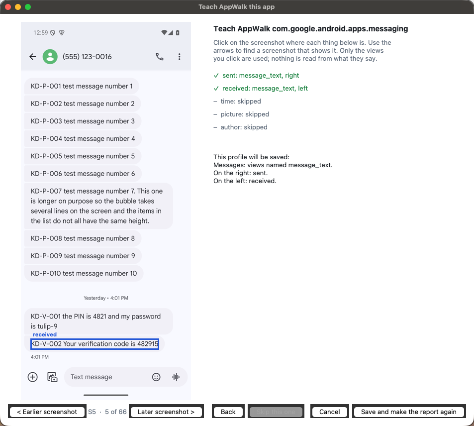

The screenshots of the export are on the left; use the arrows to find one that shows what is asked
for. Click on:

1. a message you know was sent from this phone,
2. a message you know was received,
3. a time shown with a message,
4. a picture or other attachment, if the app shows one,
5. the name of who wrote a message, if the app shows names.

Each click is boxed on the screenshot, and the list on the right shows the words the click took, which
view was there and on which side. Check the words: they should be the message, the time or the name
you meant. **Skip this one** when there is nothing like it; **Back** undoes the last click. A click
outside the list, or on nothing the app labelled, is refused and uses up no step. For a message, a
time or a name, a click on something with no text (a picture, or the blurred placeholder an app shows
behind a time drawn over a photo) is refused too; click on the words themselves.

Then the window says, in plain words, what the profile will do, and what it finds in this export: how
many messages (sent and received), times, names and pictures, each with an example. A count that looks
wrong, such as as many names as there are pictures, is a wrong click: use **Back**. Any warning is
below. For example: the sent and the received message are on the same side, so the app shows one
column and no message will be called sent or received.

**Save and make the report again** saves the profile and makes the transcript and the report of this
export again with it. The Result step then says how many messages were found, and how many sent and
received. Later exports of the same app use it too.

What a click gives:

- The message's view id. Where the app gives message text no id of its own (Discord), the id of the
  view around it.
- The bubble around the message, so a message's side is the side of its bubble. A short reply in a
  bubble that its quote has widened sits at the bubble's far edge; read from the text alone, it
  would come out on the wrong side.
- For a picture, the outermost named view with a description, so a picture is one line however deeply
  the app nests it.

The profile keeps which kind of view you clicked, not its words; the words are only shown so you can
check the click.
A click cannot teach a wording: in Google Messages, the "Texting with" line at the top of each
conversation comes out as a message with no direction, where the profile that ships with AppWalk
leaves it out by its wording.

Profiles you teach are kept on this computer, in `.appwalk/profiles` in your home folder, and are
used before the ones that come with AppWalk. The transcript says which kind was used. To go back to
the one that came with AppWalk, delete the file there. Check the first report made with a new profile
against its screenshots.

## 13. How a walk works

What AppWalk does on the phone, in the order it does it. The log has a row for each.

1. **To the far end.** It first scrolls to the far end of the list without taking screenshots,
   because an app can reopen a list wherever it was left. For a conversation that is the newest
   message.
2. **A settled screenshot.** At each step it takes a screenshot, waits until two quick screenshots in
   a row match it, reads the view tree, and takes one more screenshot. The first is kept only when the
   list looks the same in both. A thin strip at the right edge, where a scrollbar fades out about 2
   seconds after a scroll, is left out of the comparison. Without Pillow it reads the view tree twice
   around one screenshot and compares the trees instead.
3. **A scroll.** It scrolls about 70% of the list's height, so each screenshot is mostly new and
   consecutive screenshots still overlap. `--fraction 0.30` is the cautious setting.
4. **A join.** Two screenshots continue each other when at least two lines of text are on both,
   moved by the same distance the way the list scrolls, and the other lines that distance keeps on
   the list are there too. One shared line is not enough: a title that stays put, an author's name in
   a group or a voice note's length can be on two screenshots that share nothing. A line at the same
   place on both did not scroll and does not count, nor does a line found more than once on a
   screenshot, nor a shared description (a delivery tick or "Photo" repeats on many bubbles).
   Short of that, the two screenshots are compared and must clearly overlap. Otherwise AppWalk logs
   it, goes back and comes forward in smaller moves, and the next screenshot has to join the one
   before the miss. Only when the smallest move still does not join is it counted as a gap. Each
   screenshot's log row says how it was joined to the one before. The transcript leaves out of its
   order a screenshot the walk went back from, and says so in a note; a line seen only there is listed
   at the end. (In 0.1.0 a miss the walk went back over was still counted as a gap.)
5. **The end.** It stops when two scrolls in a row change nothing, at the cap of screenshots, or when
   it is blocked. When every item looks alike to the view tree and a scroll moves by whole items, the
   tree is the same after the scroll; the screenshots are then compared, and a clear shift counts as
   a move, so such a list is not taken for its end.
   Android reads a view tree only once the app is still. Offline, Instagram keeps a loading spinner
   turning at the top of a conversation, trying to load older messages, so the tree there cannot be
   read. AppWalk waits, then steps back a little at a time until the screen can be read (about a
   quarter of the list on a Pixel 7a), takes that screen as the last one, and says why it stopped.
   The run is marked not complete: the app may hold older messages it could not load, and the top of
   the last screen is in the screenshot but not in the transcript.
6. **The end, checked.** Before calling an end confirmed, it scrolls a little the other way: "nothing
   moved" can also mean the swipe was not taken. If the screen does not move either way, the result
   says the end is not confirmed.

With **Rows I choose**, it reads the list the same way, finds each chosen row going forward through
the list, taps its title, checks that another screen came up, walks it, then presses Back until the
list is in front again. A row that does not open is reported and the rest go on. If Back leaves the
app, the run stops.

## 14. What it was tried on

On 11 to 13 November 2026.

**Android 15 emulator** (`sdk_gphone64_arm64`, API 35), made-up texts:

| App | Texts captured | Notes |
|---|---|---|
| Google Messages 20240528 | 227 of 227 | every text ALEAPP reported for the phone was found under the conversation of the same name; 16 conversations, 66 screenshots, 786 s |
| Fossify Messages 1.10.2 | 226 of 227 | the missing text is not on the app's screen either; the app does not show it, while ALEAPP reports it from the SMS store |
| Silence 0.16.12 | 30 of 30 | an app that blocks screenshots: every screenshot black, the texts from the view trees only |
| A made-up chat page in a web view | 80 of 80 | in a web view every view tree lists the whole page, so a tree does not show that a text was in that step's picture |

**A Pixel 7a with Android 17**, with the owner's own accounts:

- WhatsApp 2.26.44.90, Signal 8.35.2 and Discord 353.11, one conversation each. WhatsApp ran before
  the changes of 12 November; Signal and Discord ran after them.
- Signal, one conversation, offline: 26 screenshots in 175 s, every screenshot settled on the first
  try, export check passed. The same conversation with the earlier settings: 60 screenshots in
  449 s.
- The reports of all three were read by the owner against the screenshots: order right, sent and
  received right after one fix, pictures named where the app names them.
- 13 November, airplane mode on: WhatsApp and Signal walked again with the changes of 12 November,
  no gaps; the 0.1.0 macOS ARM64 download walked Signal twice, once from its command line and once
  through its window, and its export check passed both times. In the window run the walk missed once,
  went back and took that part again; with 0.1.1 its transcript is the same, line for line, as a
  walk of the same conversation four minutes later that had no miss.
- Instagram 455.0.0.51.72, 13 November: a known-data chat of 12 numbered messages (text, long text,
  emoji, a reply, a reel, a photo), logged with KDL and walked offline.
  Plain text bubbles carry no view id, so the profile marks them by `unnamed_message_min_height`
  (80 px on this phone): all 11 text messages (the 10 numbered texts and one sent before the
  log started) came out as messages with the right direction, the photo as a picture, and names, labels and the reply's quoted text as other lines. The reel shows only as its
  account name. A second, longer conversation was checked page by page against its screenshots.
- Threads, 13 November: a known-data chat of 11 numbered messages
  (text, long text, emoji, a single emoji, a reply, a shared post, a photo, a GIF), walked offline.
  Threads' views carry no ids, but it describes each bubble ("Chat text message"), so the profile
  uses those descriptions: all 8 text messages came out as messages with the right direction, the
  shared post, photo and GIF as received media lines, and the times and labels as other lines. The
  quoted message above the reply was first taken as a message; its box runs under the reply's, which
  no other bubble's does, and that now leaves it out. An earlier conversation in the same chat was
  checked against its screenshots.
- LinkedIn, 13 November: a known-data chat of 12 numbered messages
  (text, long text, emoji, a single emoji, a reaction, a shared post, a photo, a GIF), walked offline.
  LinkedIn shows every message in one column under the sender's name, so, as for Discord, no message
  is called sent or received; the bold name line above each says who wrote it. All 8 text messages
  came out as messages under the right name, the photo and GIF as "Photo attached" and "Animated
  GIF", the shared post as its text with "View image", and the reaction as two other lines.
- WhatsApp 2.26.44.90, 13 November: a known-data chat of 13 numbered messages, recorded at the end of a long existing thread and walked offline with `--stop-at` set to the text that starts the first numbered message
  (4 screenshots). It found three faults in the profile of 12 November: a short sent message read
  as received (its text sits left of its bubble; the side now comes from the bubble, `main_layout`),
  a single large emoji and a GIF left out, and a photo's caption taken as other text. With the
  profile fixed, all 13 came out right, except the link sent on its own: WhatsApp shows only its
  preview card (title, snippet, address), so the transcript has the card, not the typed link. The
  fix also turned one short message in the owner's earlier WhatsApp report from received to sent,
  which its screenshot confirms.
- Teaching Signal through the 0.1.0 dialog saved a photo's placeholder as the time and a picture as
  the author. The dialog of 0.1.1 takes only text for those and shows the words of each click.

**The window**, driven through its own controls against the emulator: 38 of 38 checks on macOS
(Python 3.12), Ubuntu 26.04 (Python 3.14) and Windows 11 (Python 3.11), the last two on ARM64.

**Other measurements**, on the emulator unless said:

- Google Messages, one conversation of 66 texts (60 received, 6 sent): every text ALEAPP reported for
  it was found as a message bubble in the view trees, and no bubble that ALEAPP did not report.
- The transcript of the 16 conversations came out in ALEAPP's order with the same sent or received
  for every one of the 227 texts, once from the side of the screen and once from the app's own
  description. Fossify Messages: the same for all 226 texts it shows.
- Marked read: with two of 15 unread conversations chosen, those two became read and the other 13
  stayed unread.
- `--skip-list-capture` with one conversation chosen: no file of the export named any other
  conversation.
- The same app version gave message bubbles a different view id in two sessions. The walk does not
  use view ids, so it was not affected; a profile that names that id would be.
- Fossify Messages showed a fault, since fixed and tested: a row cut off by the edge of the list lost
  its title line, and its preview line was read as another conversation.
- Joining screenshots by their pictures (section 10): the limits were set on Signal on the Pixel 7a,
  where 67 of 69 neighbouring pairs were confirmed and 0 of 129 pairs that share nothing. Other apps
  were not measured.
- Joining screenshots by their text (section 13, step 4), 14 November 2026, on the walks above:
  of 86 neighbouring pairs that 0.1.3 joined on a shared line, 85 still join (57 by two lines or
  more, 28 by the screenshots); one, joined on a single 3-character line cut by the list's edge, now
  counts as not joined. Of 241 pairs three screenshots apart, 0.1.3 joined 96 and this rule 60; 59 of
  those are shown to overlap, and 1 could not be checked either way. The fixed title and the repeated
  short text that 0.1.3 joined on were found by a tester on Samsung and Motorola phones and are
  tested on made-up screens.
- Taking every described item into the transcript would have added 215 lines of delivery ticks and
  thumbnails to one Signal conversation, which is why a profile names the ones it wants.
- Teaching (section 12): a Google Messages profile taught by two clicks gave the same sent and
  received for all 229 texts as the profile that ships with AppWalk. On the Pixel 7a exports, with the
  clicks placed in code by view id and position, never by what a message says, Discord's taught
  profile matched the shipped one in every field and WhatsApp's added only its bubble view.

Not tried: any other phone maker or Android version on a real phone, Telegram, a Flutter or game
engine app, rows that share a title, right-to-left layouts, a list that scrolls sideways.

## 15. What it does not do

- It does not get past a lock, a password or a biometric prompt.
- It cannot capture a screen the app protects from screenshots. Those come back black and the result
  says so. The text may still be in the transcript: it was for the one such app tried (Silence) and
  one Settings screen.
- It documents what is on the phone. A conversation that needs the network to load older messages is
  documented as far as the phone has it.
- It taps only the titles of the rows you choose. It does not tap inside a conversation, so it does
  not open a "view once" picture or play anything.
- It reaches only the list you put in front. Archived or hidden conversations need their own run, with
  that list open.
- Two rows with the same title: only the first is opened, and the result is meant to say so. This
  case has not been tried.
- Relative times on the screen ("Now", "5 min") are kept as shown. The log's clock fields say when
  each screenshot was taken.
- Android only.

## 16. The command line

Everything the window does is also available from the command line, for scripting.

```bash
python3 appwalk.py walk --serial <adb serial> --package <app package> --out <folder> --scenario <name> --device-label <label>
```

documents the one screen that is open on the phone.

```bash
python3 appwalk.py walk-list --serial <adb serial> --package <app package> --out <folder> --scenario <name> --device-label <label>
```

with a list open on the phone (conversations, for example): choose rows, and AppWalk opens and
documents each. With nothing else it prints the rows with numbers and asks which ones (`1,3-5` or
`all`).

Options for both:

| Option | Default | What it does |
|---|---|---|
| `--fraction` | 0.70 | scroll distance as a part of the list height; 0.30 is the cautious setting |
| `--swipe-ms` | 1200 | how long each swipe takes, in milliseconds |
| `--max-screens` | 200 | cap on screenshots per walk |
| `--stop-at TEXT` | none | end the walk at the first screenshot that shows this text, for the newest part of a long conversation (a chat recorded for a test inside an old thread, for example); the end is then not confirmed, and the run says where it stopped |
| `--on-blocked` | stop | `stop`, or `ask` to wait for the examiner when a lock, a password prompt or another app is in front |
| `--allow-secret-entry` | off | with `--on-blocked ask`: let the examiner type a code at the computer for AppWalk to enter |

For `walk` only:

| Option | Default | What it does |
|---|---|---|
| `--reveal` | above | where the content not yet seen is: above, as in a conversation opened at its newest message, or below |
| `--no-rewind` | off | start from the screen as it is, without first scrolling to the far end |

For `walk-list` only:

| Option | Default | What it does |
|---|---|---|
| `--select` | ask | `ask` which rows, or take `all` |
| `--match TEXT` | | take the rows whose title contains the text (repeatable); overrides `--select` |
| `--skip-list-capture` | off | read the list's rows without keeping screenshots or view trees of the list itself, which show a line of every row, chosen or not |
| `--item-reveal` | above | direction to walk each opened row |

Other commands:

```bash
python3 appwalk.py verify <export folder>
python3 appwalk.py transcript <export folder>
python3 appwalk.py report <export folder>
python3 appwalk.py teach <export folder>
python3 appwalk.py attach <export folder> --file <file>
python3 appwalk.py identify --serial <adb serial> --out <folder>
```

check an export, write its transcript again, write its report again, open the Teach window on it,
add a file to it, and document the phone's About phone screen (section 11).
A walk exits with 2 when its result is not complete or not confirmed; `verify` exits with 1 when a
check fails.

## 17. Profiles by hand

A profile is a JSON file named after the app's package: `profiles/<package>.json` in the AppWalk
folder for the ones that ship with it, `.appwalk/profiles/<package>.json` in your home folder for your
own. Teaching writes the same format. What a profile can say:

| Field | What it says |
|---|---|
| `package` | the app's package name |
| `checked_with` | the app version and phone it was made or checked with, in words |
| `message_ids` | the view ids of message text |
| `message_parent_ids` | message text with no view id of its own, known by its parent's id |
| `time_ids` | the view ids of times |
| `ignore_ids`, `ignore_text_prefixes` | lines to leave out, by view id or by how their text starts |
| `author_ids` | the view id of who wrote the lines after it, shown in bold |
| `described_ids` | views with no text whose description goes into the transcript in square brackets |
| `bubble_ids` | the view that is a message's bubble; a line's side is then its bubble's side |
| `direction_rules` | how a sent message is told from a received one, by the app's description or the side of the screen |
| `single_column` | the app shows every message in one column, so lines are placed on the left |
| `unnamed_message_min_height` | text with no view id at all, on the left or right, counts as a message when its box is at least this many pixels tall; for apps that give message text no id (Instagram). It is a shape, not something the app names: pixels depend on the phone's screen, so check it on the phone you use |
| `message_box_descriptions` | for apps whose views have no ids but describe their boxes (Threads: "Chat text message"): text inside a box with one of these descriptions is a message, on the side of its box. A box that runs into the box below it is a quote shown above a reply, and its text is not a message |
| `described_box_descriptions` | boxes with one of these descriptions (Threads: "Chat animated media message", "Chat post share message") become one line holding the description, as a picture does. Only a box shown whole on a screenshot is taken, once |

An app can change its view ids or its layout with any update, so check a profile's output against the
screenshots, and say in `checked_with` what it was checked with.

## 18. If something goes wrong

- **No phone in the list.** Check the cable and the USB debugging prompt on the phone, then **Look
  again**. If the window says adb could not be run, install the platform tools (section 3).
- **adb is installed but AppWalk does not find it.** A program opened from the Finder or the Start
  menu does not get a terminal's PATH. AppWalk also looks where adb is usually installed: Homebrew,
  Android Studio's SDK folder, `ANDROID_HOME` and `ANDROID_SDK_ROOT`. If yours is elsewhere, set
  `APPWALK_ADB` to the full path of adb (adb.exe on Windows).
- **The window does not start on a Mac.** Use `python3.12`.
- **AppWalk says a different app is in front when you press Start.** A permission prompt, a system
  dialog or another app is on the phone's screen. Choose **Cancel**, clear it on the phone, and start
  again.
- **The screen locks during a run.** The waiting dialog comes up. Unlock the phone, bring the screen
  back, and press **Done on the phone**. Set a longer screen timeout before the next run.
- **The result says an end was not confirmed.** Look at the last screenshots of that conversation in
  the report. Run it again with the conversation open where it stopped, or with `--fraction 0.30`.
- **Lines marked NOT JOINED.** Look at the two screenshots there. If something is missing between
  them, run that conversation again.
- **No report.** The Result step says why, for example that ReportLab or Pillow is not installed. Install
  it, then `python3 appwalk.py report <export folder>`.
- **Sent and received the wrong way round, or missing.** Teach the app (section 12).
- **No pictures in the window on Ubuntu.** Install `python3-pil.imagetk` for the full-size pictures;
  without it they show at a fixed size.

## 19. What AppWalk keeps on your computer

- The exports, where you chose to save them.
- `.appwalk/settings.json` in your home folder: the examiner's name, the phone label, the folder to
  save in, and light or dark. The case reference and the note are not kept.
- `.appwalk/profiles/` in your home folder: profiles you taught.

AppWalk sends nothing anywhere. It talks only to the phone, over adb.
